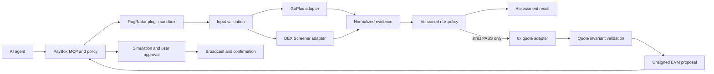

# RugRadar development plan

Status: Assessment release submitted; private agent exercise, review, and public demo remain
Plan date: 2026-10-16
Initial release target: PayBox Chapter 1 submission
Primary platform: Base mainnet through a PayBox marketplace plugin

## 1. Outcome

Build an agent-native token-risk gate that makes uncertainty visible and refuses to propose a purchase when critical evidence is adverse or incomplete.

The submission is successful when:

- the plugin works end to end in PayBox, not only in a local MCP client;
- an assessment returns a schema-valid, human-readable, evidence-backed verdict;
- all negative and provider-failure cases fail closed;
- if the guarded-buy milestone is included, it can only propose a transaction for the token assessed inside that same invocation;
- the proposal is validated and simulated by PayBox using the intended Base wallet;
- no secret, private key, build cache, source map, or unrelated artifact is committed or uploaded;
- a short X video demonstrates both an allowed and a refused path; and
- repository, uploaded artifact, hosted configuration, submission, and public demo states are recorded separately.

## 2. Scope

### Must ship

`assess_token_risk`

- Input: one EVM token contract address.
- Fixed chain: Base mainnet (`8453`, `eip155:8453`).
- Providers: GoPlus for security evidence and DEX Screener for market context.
- Output: token identity, verdict, confidence/coverage, blockers, warnings, normalized evidence, source status, policy version, and observation time.
- Behavior: strictly validate input and upstream data; return `UNKNOWN` for material coverage gaps.

### Ship only after all action gates pass

`propose_guarded_buy`

- Inputs: buy-token address, taker public address, exact ETH amount, and bounded slippage.
- Re-run the complete risk assessment in the same call.
- Continue only on strict action-policy `PASS`.
- Request a firm native-ETH-to-token quote from 0x on Base.
- Validate quote invariants before returning one unsigned PayBox EVM proposal.
- Refuse without a proposal for `REVIEW`, `BLOCK`, `UNKNOWN`, provider error, quote inconsistency, or policy breach.

### Explicitly out of scope for the hackathon release

- Claims that a token is safe, legitimate, audited, or guaranteed sellable.
- Solana or any chain other than Base.
- Portfolio scanning, background monitoring, webhooks, persistence, accounts, or a custom UI.
- ERC-20-input swaps that may require a separate allowance transaction.
- Permit2 or arbitrary typed-data signatures.
- Selling a token, revoking approvals, or rescue/recovery workflows.
- User-authored policies or arbitrary provider/router URLs.
- Direct signing, private-key access, broadcasting, or transaction-status polling inside plugin code.
- A proprietary machine-learning score.

## 3. Principles and invariants

1. **Unknown is not safe.** Missing high-signal fields, unsupported analysis, and upstream failure cannot produce `PASS`.
2. **Evidence precedes verdict.** Every blocker and warning maps to a named normalized observation.
3. **No cross-call authorization.** A prior `assess_token_risk` result is informative only. The action tool rescans.
4. **Address identity is exact.** Validate and canonicalize addresses to lowercase for comparison, and bind all evidence and future quote validation to the same Base address. Names and symbols are informational only.
5. **External data is untrusted.** Parse with strict bounded schemas, reject unexpected types at decision boundaries, and never interpolate raw provider text into trusted claims.
6. **No silent degradation.** Source failures and omitted fields appear in `coverage.gaps` and affect the verdict.
7. **One proposal, one intent.** The EVM destination, value, calldata, buy token, taker, amount, slippage, chain, and expiry must agree.
8. **Amounts are exact strings.** Never use JavaScript floating point for wei, token amounts, taxes, or slippage calculations.
9. **Discovery has no side effects.** Network calls occur only inside tool handlers.
10. **A proposal is not execution.** Simulation, approval, broadcast, and confirmed receipt remain separate PayBox lifecycle steps.

## 4. System design



### Trust boundaries

- **Agent input:** untrusted addresses, amounts, and instructions.
- **Plugin code:** trusted only after review, deterministic build, and artifact hash verification.
- **Provider responses:** untrusted external data; normalize and validate.
- **Policy engine:** deterministic, pure, versioned, and covered by table tests.
- **0x quote:** untrusted transaction construction input; verify invariants.
- **PayBox:** wallet selection, approval, signing, simulation, broadcast, and confirmation boundary. Plugin code never handles keys.
- **Human:** final review and approval, especially because PayBox does not promise a decoded trusted swap summary for generic calldata.

## 5. Repository architecture

Start from every file in PayBox starter v1.0.2 and preserve its pinned dependencies and test scripts.

```text
RugRadar/
  src/
    plugin.ts                 MCP server and tool registration only
    paybox.ts                 exact official starter helper
    config.ts                 fixed chain, hosts, timeouts, and policy version
    schemas.ts                MCP input/output and upstream boundary schemas
    domain/
      evidence.ts             normalized domain types
      policy.ts               pure verdict engine
      assessment.ts           provider orchestration and result assembly
      amounts.ts              exact decimal/atomic conversions, milestone 4
    providers/
      goplus.ts               token-security adapter
      dexscreener.ts          market-context adapter
      zeroex.ts               guarded quote adapter, milestone 2
    tools/
      assess-token-risk.ts
      propose-guarded-buy.ts  milestone 4
  test/                       deterministic unit and boundary tests
  scripts/                    official starter scripts, unchanged unless required
  docs/
    research/
    DEVELOPMENT_PLAN.md
    RUNBOOK.md                 added during implementation
    DEMO.md                    added before submission
  paybox-plugin.json
  starter-version.json
  package.json
  pnpm-lock.yaml
  pnpm-workspace.yaml
  tsconfig.json
```

Keep business logic out of `plugin.ts`. Provider adapters own transport and external schemas; the domain layer never consumes raw JSON.

## 6. Tool contracts

### 6.1 `assess_token_risk`

Implemented input:

```json
{
  "tokenAddress": "0x..."
}
```

Implemented output shape (abridged):

```json
{
  "chain": "eip155:8453",
  "token": {
    "address": "0x...",
    "name": "Example",
    "symbol": "EXM"
  },
  "verdict": "REVIEW",
  "policyAllowsAction": false,
  "policyVersion": "2026-10-17.2",
  "observedAt": "2026-10-17T00:00:00.000Z",
  "blockers": [],
  "warnings": [
    {
      "code": "UPGRADEABLE_PROXY",
      "severity": "WARNING",
      "message": "The token uses a proxy or delegated implementation path."
    }
  ],
  "coverage": {
    "level": "COMPLETE",
    "sources": [
      { "name": "goplus", "status": "AVAILABLE", "latencyMs": 120 },
      { "name": "dexscreener", "status": "AVAILABLE", "latencyMs": 95 }
    ],
    "gaps": []
  },
  "evidence": {
    "security": {},
    "market": {}
  },
  "limitations": [
    "Automated evidence is not a smart-contract audit, financial advice, or a guarantee against loss."
  ]
}
```

Contract rules:

- Use closed enums and `.strict()` objects at MCP boundaries.
- Keep warning/blocker codes stable and machine-oriented; human messages may evolve.
- Omit unstable raw payloads and URLs not needed by the agent.
- `observedAt` is when RugRadar observed the response, not proof of provider data freshness.
- A provider timeout should normally produce a valid `UNKNOWN` assessment, not a misleading `PASS`.
- Reserve MCP `isError` for invalid inputs, total internal failure, or inability to produce a schema-valid assessment. A risky token is a successful assessment with `BLOCK`.

### 6.2 `propose_guarded_buy`

Input draft:

```json
{
  "buyToken": "0x...",
  "taker": "0x...",
  "amountEth": "0.001",
  "slippageBps": 100
}
```

Rules:

- `amountEth` is a canonical decimal string with at most 18 decimals and must be positive.
- Set a conservative v1 maximum in code for the demonstration; document it and test both sides of the boundary.
- `slippageBps` is an integer in a narrow range, initially 30–200 bps.
- The tool repeats `assessTokenRisk(buyToken)` internally.
- Refusal is a schema-valid result with no `io.paybox/transactionProposal` property.
- An allowed result includes the assessment summary, normalized quote summary, exact expected/minimum buy amounts from the provider, and the standard PayBox proposal.
- The user must select the same public wallet supplied as `taker`; mismatch should fail simulation and is called out in the tool text.

Quote invariants before proposal creation:

- request and response chain are Base (`8453`);
- requested buy token equals normalized returned buy token;
- sell token is the 0x native-token sentinel;
- quote taker equals input taker where echoed or encoded;
- liquidity is available and no blocking issue is present;
- returned sell amount and transaction `value` equal the requested wei amount;
- buy and minimum-buy amounts are positive decimal integers and meet slippage expectations;
- transaction destination is a currently permitted 0x execution contract for Base;
- calldata is non-empty, even-length hex within a strict size bound;
- provider expiry, if any, is valid and the PayBox expiry never extends it;
- redirects are rejected and response size is bounded;
- no provider field is copied into the transaction proposal without validation.

## 7. Risk policy v1

### Verdict semantics

| Verdict | Meaning | Action eligibility |
|---|---|---:|
| `BLOCK` | One or more deterministic critical conditions are present. | No |
| `REVIEW` | Evidence is available but contains material non-critical concerns. | No in v1 |
| `UNKNOWN` | Coverage is insufficient to make the strict decision. | No |
| `PASS` | Required checks are present and no v1 blocker or review condition fired. | Yes, subject to quote and PayBox gates |

`PASS` means only "the current evidence satisfies policy v1." It must never be rendered as "safe."

### Initial hard blockers

The implemented blocker mapping is:

- explicit honeypot finding;
- cannot buy, cannot sell all, or sell restriction finding;
- hidden owner or reclaimable ownership;
- owner-configurable per-address tax/slippage;
- modifiable taxes; provider trust never overrides an explicit adverse value;
- blacklist/whitelist controls capable of selectively blocking users;
- transfer pausing;
- closed source;
- self-destruct behavior;
- buy, sell, or transfer tax above 1,000 basis points.

Malformed data and missing required security fields produce `UNKNOWN`, unless another explicit blocker is already present. The trusted-token exception only relaxes missing proxy-dependent fields; it does not erase explicit findings.

### Review conditions

- upgradeable proxy or delegate-call path without an additional critical finding;
- retained owner privileges that are transparent but material;
- very young deepest pair;
- deepest-pair liquidity below USD 50,000 or no matching Base pair;
- nonzero but sub-ceiling transfer/buy/sell taxes;
- unusual trading cooldown, anti-whale, or external-call behavior;

### Unknown conditions

- all primary providers unavailable;
- token record missing;
- required GoPlus high-signal fields omitted because analysis is unsupported;
- timeouts or rate limits that remove required coverage;
- response schema drift;
- no contract/code identity evidence;
- only market data available.

### No numeric score in v1

A weighted score is deferred until there is a labeled fixture corpus, explicit calibration methodology, versioned thresholds, and false-positive/false-negative analysis. Counts of blockers/warnings may be displayed, but they are not probabilities.

## 8. External-call engineering

- Use `AbortSignal.timeout` with a 3.5-second per-provider budget and a concurrent total under eight seconds.
- Call GoPlus and DEX Screener concurrently; convert unexpected adapter rejection into a structured unavailable result.
- Cap response bytes before JSON parsing where the runtime permits; reject oversized results.
- Use `redirect: "error"`.
- Hardcode exact HTTPS origins; never accept user-supplied hosts or paths.
- URL-encode only validated addresses.
- Parse JSON once into `unknown`, then through a bounded Zod schema.
- Classify upstream outcomes: `AVAILABLE`, `NO_DATA`, `TIMEOUT`, `RATE_LIMITED`, `HTTP_ERROR`, `INVALID_RESPONSE`.
- Do not expose arbitrary upstream error bodies to the agent.
- Log concise diagnostic codes to stderr only; never log secrets or full responses.
- Do not retry automatically inside the ten-second sandbox. A rate-limited or uncertain result is `UNKNOWN`.

## 9. Security and abuse model

| Threat | Control | Verification |
|---|---|---|
| Address confusion or symbol impersonation | Address is the primary identity; fixed chain; display symbol is informational. | Mixed-case, zero, malformed, and lookalike tests. |
| Provider says missing field equals false | Optional fields normalize to `UNKNOWN`; policy requires coverage. | Sparse fixture tests. |
| Provider schema drift | Strict adapter schemas plus explicit unavailable state. | Mutation/contract fixtures. |
| Huge or malicious upstream payload | Time, byte, array-count, string-length, and output-size bounds. | Oversize fixture tests. |
| Prompt injection in token metadata | Treat names/symbols/URLs as data, length-limit them, never include instructions from providers. | Hostile metadata fixtures. |
| TOCTOU between scan and action | Re-scan in guarded tool immediately before quote; short proposal expiry. | Test that prior result cannot be supplied as authorization. |
| Quote token/amount substitution | Validate every request/response invariant and exact atomic values. | Tampered quote fixtures. |
| Malicious router destination | Allow only verified current 0x execution targets or validated signed response policy. | Unknown-destination refusal tests. |
| Secret exposure | PayBox brokered host header; no environment read for the key; redact logs/errors. | Bundle scan and hosted negative test. |
| Approval abuse | Native ETH input only in v1; no approval transaction. | Tool schema and calldata-path review. |
| Replay/stale proposal | Whole-second RFC3339 expiry within five minutes and no extension beyond quote. | Fake-clock boundary tests. |
| Duplicate execution after unknown outcome | Plugin creates proposals only; agent must poll PayBox request and inspect terminal status before retrying. | Runbook/demo narration. |
| False assurance | Categorical policy language, evidence/gaps, prominent limitations, no "safe" claim. | Snapshot/content tests and manual review. |

## 10. Testing strategy

### Unit tests

- EVM address validation and canonical comparison.
- Exact decimal-to-wei conversion at zero, minimum, maximum, and excess precision.
- GoPlus string booleans, decimal tax parsing, absent fields, proxy/closed-source behavior, and response identity.
- DEX Screener pair filtering, aggregation, age calculation, and null/overflow handling.
- Every policy rule in isolation and in conflicts.
- Verdict precedence: `BLOCK` over `UNKNOWN`, then define and test how coverage affects mixed cases.
- Stable warning codes and deterministic ordering.
- Human summary generated only from normalized evidence.

### Contract/fixture tests

Commit minimal, sanitized fixtures representing:

- known liquid trusted token;
- explicit honeypot;
- closed-source token;
- upgradeable token with otherwise healthy evidence;
- high and modifiable tax;
- blocked sells;
- sparse/unsupported response;
- wrong token key/address;
- invalid JSON and schema drift;
- GoPlus success plus DEX Screener outage;
- both providers unavailable;
- maliciously long/token-like metadata.

Fixtures prove parsing and policy behavior; they do not prove current live-token status.

### Action tests

- refusal for every non-`PASS` verdict;
- exact binding of assessment token to quote buy token;
- wrong chain, token, taker, sell amount, value, destination, or calldata refusal;
- allowance issue refusal even though native input should avoid it;
- absent liquidity and provider simulation warning refusal;
- slippage and amount boundary tests;
- quote expiry earlier than PayBox default;
- no proposal property in refused output;
- valid proposal matches the inline declared output schema.

### Integration tests

- Live GoPlus and DEX Screener smoke tests are opt-in and never the only proof.
- Use Base USDC/WETH only as known-address connectivity checks, not as permanent expected-value snapshots.
- Run one 0x quote smoke test only when a local key is available; never print the key or response headers.

### Platform tests

- `pnpm install --frozen-lockfile` in WSL2/Node 24.21.0.
- `pnpm test` for typecheck, two byte-identical builds, and MCP conformance.
- Verify `dist/plugin.mjs` is UTF-8, under 10 MiB, and has the reported SHA-256.
- Scan the bundle and Git history for secrets and forbidden artifacts.
- Run hosted PayBox checks with only documented hosts.
- Test both allowed and refused tool outputs in the portal.
- Validate (simulate) the proposal with the intended Base wallet.
- If explicitly approved, execute only a tiny real transaction and record the confirmed hash separately.

## 11. Runtime configuration

### Assessment-only plugin

Allowed hosts:

- `api.gopluslabs.io`
- `api.dexscreener.com`

Secrets: none for the researched public endpoints. Reconfirm GoPlus auth/quota requirements in the portal.

### Guarded-buy plugin

Additional allowed host:

- `api.0x.org`

Brokered secret:

- Host: `api.0x.org`
- Header: `0x-api-key`
- Value: participant-owned 0x API key

The non-secret `0x-version: v2` header is set in code. Never store the key in `.env`, the bundle, sample arguments, docs, screenshots, or demo output.

## 12. Implementation milestones

The deadline-driven sequence intentionally creates a valid submission candidate before the action stretch.

### Milestone 0 — owner gates and repository baseline (complete locally except owner-controlled gates)

- Confirm PayBox registration/KYC and portal access.
- Confirm public/private repository preference and demo X account.
- Initialize `main`, commit planning docs, add the GitHub remote, push, and verify remote SHA.
- Create an issue/checklist for external submission gates.

Exit: remote contains the reviewed plan and no artifacts/secrets.

### Milestone 1 — trusted starter and skeleton (complete)

- Copy every PayBox starter v1.0.2 file from the official source.
- Verify files against the official starter manifest.
- Rename the sample project/server to RugRadar without changing tooling behavior.
- Run the untouched echo starter in WSL2.
- Add CI on Linux Node 24.21.0 after the repository owner's GitHub Actions billing lock is resolved. Until then, preserve the exact local validation record and do not claim CI proof.

Exit: untouched starter passes; deterministic artifact hash recorded.

Commit: `chore: bootstrap PayBox plugin starter`

### Milestone 2 — normalized assessment core (complete locally)

- Implement schemas, provider adapters, exact parsing, evidence model, source statuses, and concurrent orchestration.
- Implement policy v1 as a pure function.
- Register `assess_token_risk` with strict MCP schemas and annotations.
- Add fixture/unit/contract tests and concise summaries.
- Add `RUNBOOK.md` with hosts, limits, failure meanings, and local commands.

Exit: focused tests and full PayBox local test pass; negative cases cannot produce `PASS`.

Commit: `feat: add evidence-backed Base token assessment`

### Milestone 3 — hosted assessment proof (complete)

- Upload the exact tested bundle.
- Configure only GoPlus and DEX Screener hosts.
- Run hosted checks and multiple portal tool calls.
- Capture artifact SHA-256, hosted version ID/status, sample outcomes, and timestamps.
- Fix any real sandbox/network/schema issue and repeat all affected gates.

Exit: assessment works through PayBox and is demo-ready.

Commit: `docs: record hosted assessment validation`

### Milestone 4 — guarded buy (2–3 hours, optional but preferred)

- Obtain/configure 0x key as a brokered header.
- Implement quote adapter, amount/slippage bounds, invariant validation, refusal output, and proposal creation.
- Add exhaustive tampered-quote tests.
- Run live quote smoke test, full local suite, hosted checks, and PayBox validation.
- Do not include this tool if any invariant or hosted validation remains unresolved.

Exit: strict pass yields one accurately bound proposal; every other state yields no proposal.

Commit: `feat: add guarded Base token buy proposal`

### Milestone 5 — submission package and demo (submission complete; private exercise and public demo pending)

- Freeze code early enough to retest the final bytes.
- Write `DEMO.md` with exact prompts, addresses, expected verdicts, refusal path, proposal path, and caveats.
- Record a short video showing the live PayBox flow, not a local terminal only.
- Show a passing assessment, a blocked/unknown assessment, and guarded proposal validation if included.
- Avoid exposing accounts, email, API keys, wallet balances beyond what is intentionally public, or unrelated browser content.
- Upload final `plugin.mjs`, rerun checks, accept terms, select **Submit Project**, enable private plugin, run through the agent, and post the demo to X.

Exit: submission confirmation and X URL recorded with final artifact hash.

Commit: `docs: finalize RugRadar submission and demo runbook`

### Milestone 6 — post-submission hardening

- Verify the GitHub remote branch SHA equals local `main` after the final push.
- Tag the submitted source commit and record the mapping to artifact SHA/version.
- Monitor provider schema changes and rotate credentials through PayBox, not code.
- Triage review feedback without confusing a settings update with a code-version update.

## 13. Release gates

### Code gate

- No placeholder handlers, dead tools, debug bypasses, TODO-based allow paths, or unused dependencies.
- Strict TypeScript and lint/format checks pass.
- Policy and provider code have targeted review.
- Every significant round has a focused commit.

### Security gate

- Secret scan clean across tracked files and built bundle.
- Exact network hosts documented.
- No private key, seed phrase, wallet ID, RPC URL, or signing instruction in a proposal.
- All error paths preserve fail-closed semantics.
- No unsupported "safe," "guaranteed," or "audit" claim.

### Test gate

- Unit/fixture/action tests pass.
- Official `pnpm test` passes on the required toolchain.
- Deterministic artifact SHA and size recorded.
- Hosted checks and representative portal calls pass.
- Proposal validation passes if the action tool ships.

### Product gate

- Output is useful without exposing raw provider payloads.
- Risk codes are stable and explainable.
- Allowed and refused paths are visually distinct in PayBox.
- Limitations and evidence gaps are visible.
- Demo does not depend on a mutable known-scam address without a fallback fixture/story.

### Submission gate

- Participant eligibility/KYC confirmed.
- Final upload occurs before October 17 at 20:00 EDT / October 18 at 02:00 SAST.
- Hosted version corresponds to the final local artifact hash.
- Project is explicitly submitted, not merely uploaded.
- Plugin is enabled and exercised through the agent.
- X demo is public and its URL is recorded.

### Delivery gate

- `git status` clean except intentional local-only ignored files.
- No `dist`, `.env`, APK/AAB, logs, caches, or temp files tracked.
- Remote `main` SHA verified after each push.
- Submission, hosted validation, transaction validation, and any real execution are reported as separate facts.

## 14. Observability and operations

Because each call is a fresh sandbox, observability must be compact and non-sensitive:

- generate a short random/request correlation ID per invocation;
- log tool name, policy version, provider status codes, elapsed milliseconds, verdict, and refusal code to stderr;
- do not log full addresses unless needed for diagnosis; never log secrets or raw provider bodies;
- return source availability and observation time in structured output;
- keep a changelog for policy versions and provider schema updates;
- maintain a kill switch by removing the 0x host or secret in PayBox configuration if the action path must be disabled without republishing;
- treat provider changes, new router destinations, and policy-threshold changes as reviewable release changes.

## 15. Documentation deliverables

During implementation, add and maintain:

- `docs/RUNBOOK.md`: prerequisites, WSL2 setup, exact commands, portal hosts/secrets, troubleshooting, and recovery.
- `docs/DEMO.md`: reproducible judge flow and fallback tokens/cases.
- `CHANGELOG.md`: policy and tool behavior changes.
- `.env.example` only if local optional integration tests need non-secret variable names; never include values.
- Source/license attribution for PayBox starter and third-party libraries.
- A final validation record containing commit SHA, artifact SHA, size, toolchain, hosted check result, portal test result, proposal validation result, submission status, and X URL.

## 16. Post-hackathon roadmap

### Phase 2 — stronger evidence

- Add direct on-chain code hash and proxy implementation resolution through a vetted Base RPC.
- Add contract creation/deployer history and malicious-address evidence.
- Add response signature verification for quote providers.
- Build a labeled regression corpus from immutable historical examples.
- Calibrate thresholds and measure false positives/negatives before considering a numeric risk score.

### Phase 3 — protective actions

- Detect and propose revocation of risky ERC-20 allowances.
- Support already-approved USDC inputs with explicit allowance verification.
- Add a two-step approval workflow only if PayBox exposes an appropriate reviewed pattern.
- Add sellability preflight and guarded exit proposals without claiming execution certainty.

### Phase 4 — broader product

- Versioned user/organization policies managed outside ephemeral plugin state.
- Portfolio exposure scan and alerting service.
- Additional EVM chains after per-chain provider and router validation.
- Solana only as a separately designed product using Solana-specific security evidence and PayBox's unsigned transaction rules.
- Public metrics on verdict distribution, coverage gaps, provider latency, and policy drift with privacy-preserving aggregation.

## 17. Immediate next action

Enable the submitted plugin privately in PayBox, invoke `assess_token_risk` through an agent, record that user-journey evidence, and complete the short public demo without overstating what a `PASS` verdict means.
